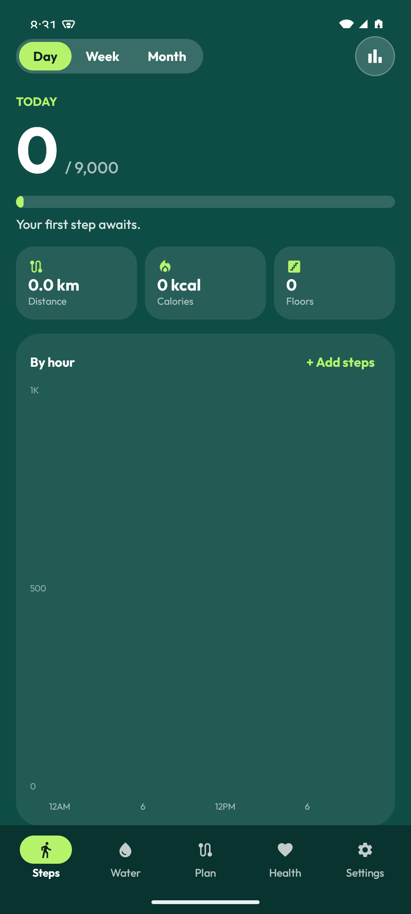
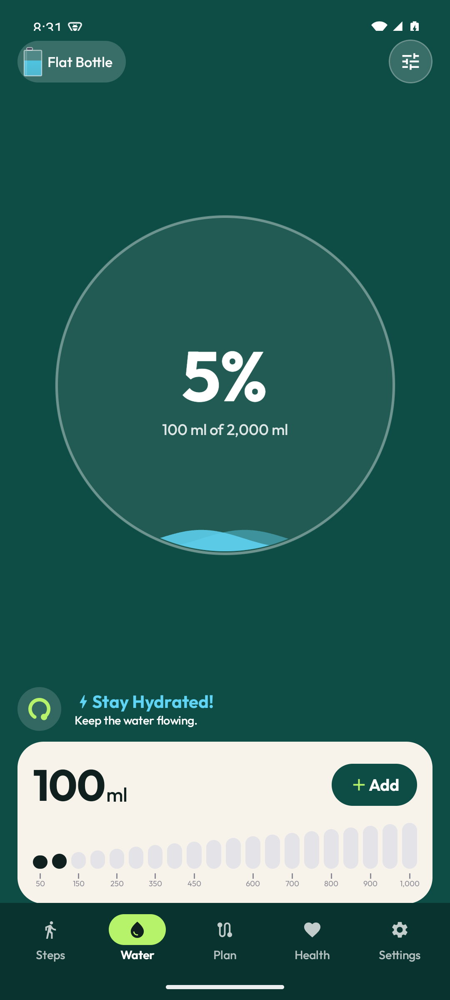
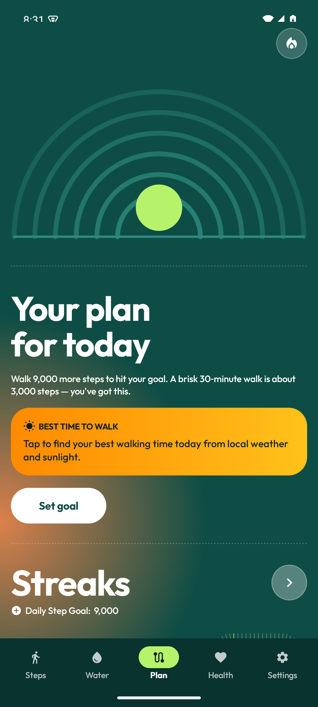
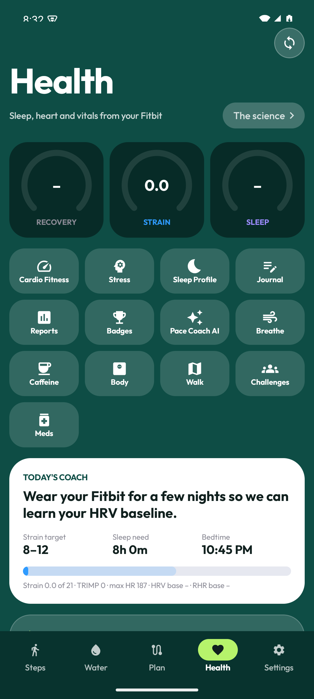
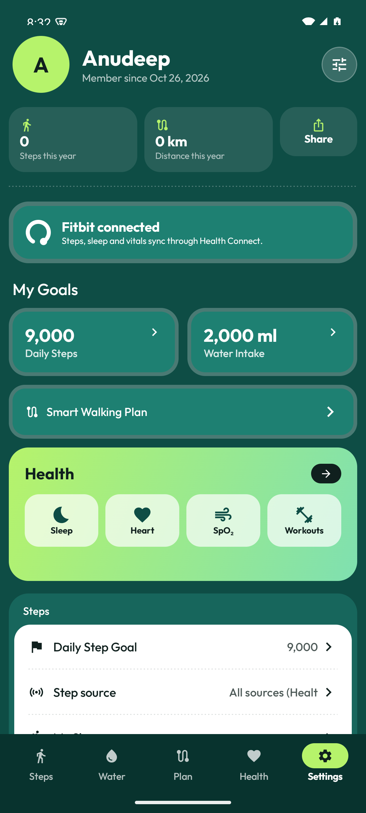
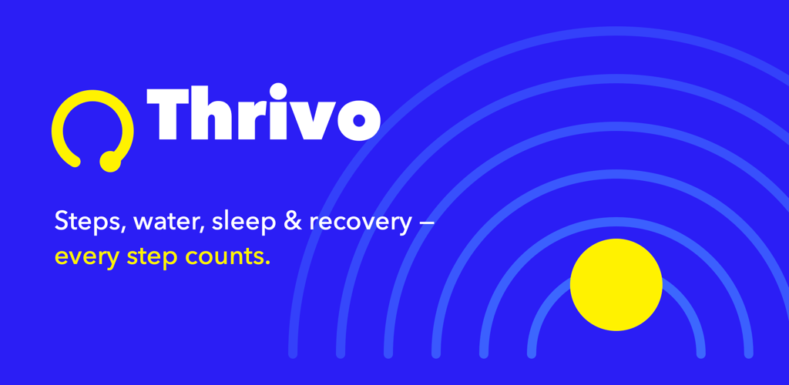

# Thrivo

## Screenshots

<p align="center">





</p>

<p align="center"></p>

Android health tracker in Kotlin and Jetpack Compose. It reads the data your Fitbit syncs to Health Connect and turns it into a daily view.

## What it does
- **Steps:** day, week and month charts, with step counts from Fitbit only (other apps' duplicate counts are filtered out).
- **Calories:** active and resting calories, split the way Fitbit does it (15-minute blocks, resting rate measured overnight), plus calories from walking.
- **Recovery, strain and sleep scores:** built on published research (HRV, resting heart rate, sleep guidelines). Each score lists its inputs and sources in *The science*.
- **Workouts:** treadmill (speed up to 25 km/h, incline up to 20%), outdoor GPS, bike, strength and HIIT, with a rest timer and voice cues. Sessions save to Health Connect.
- **Fat-loss plan:** a 5-day, 12-week plan built from lab values. Cardio targets, protein range and exercise images, with form cues and alternatives.
- **Water, caffeine, medication, journal, breathing and cycle tracking.**

Everything stays on the phone. Health data is only read from Health Connect.

## Build
Requires Android Studio (or Gradle 9) with the Android SDK, JDK 17+ and a phone or emulator running Android 9 or newer.

```bash
gradle :app:assembleDebug
```

For a release build, create `keystore.properties` next to `settings.gradle.kts` with `storeFile`, `storePassword`, `keyAlias` and `keyPassword`. The keystore is not in this repo.

## Structure
- `app/src/main/java/app/thrivo/`
  - `Data.kt`: Health Connect reads and writes
  - `Coach.kt`, `Research.kt`: scores and sources
  - `Workout.kt`, `WorkoutUI.kt`, `Speed.kt`, `Rides.kt`: workouts and ride detection
  - `Plan.kt`, `PlanScreen.kt`: fat-loss plan and merged Plan tab
  - `MetricDetail.kt`: hourly, daily, weekly and monthly detail views
- `app/src/main/assets/exercises/`: public-domain exercise images (free-exercise-db)
- `app/src/test/`: unit tests for the science formulas, calorie maths and plan rules
- `play-store/`: listing text, privacy policy, data-safety answers, icon, feature graphic and screenshots

## Not medical advice
Scores and ranges are informational estimates from published guidelines. They don't diagnose anything. Share lab results and any worrying readings with a doctor.
